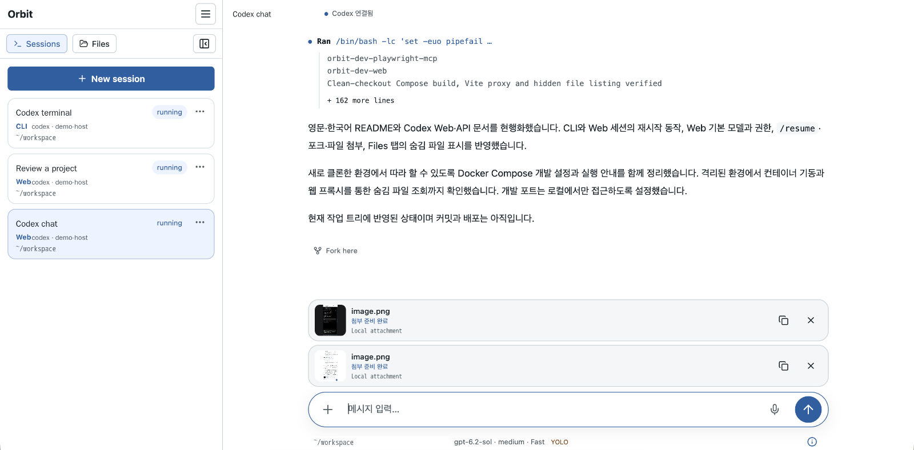
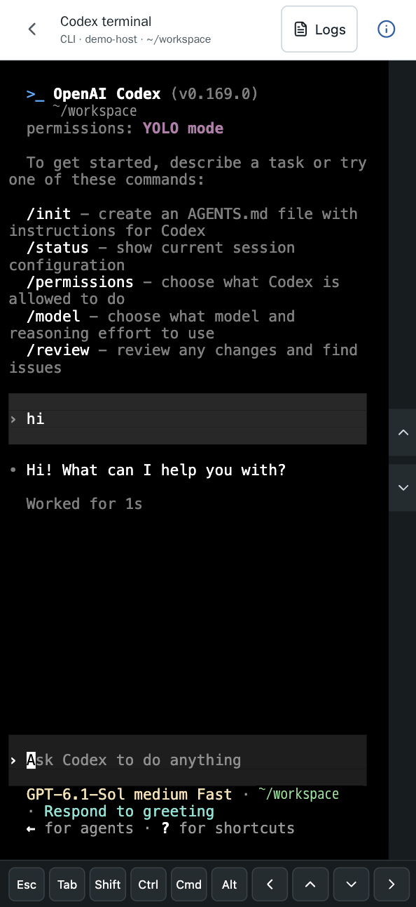
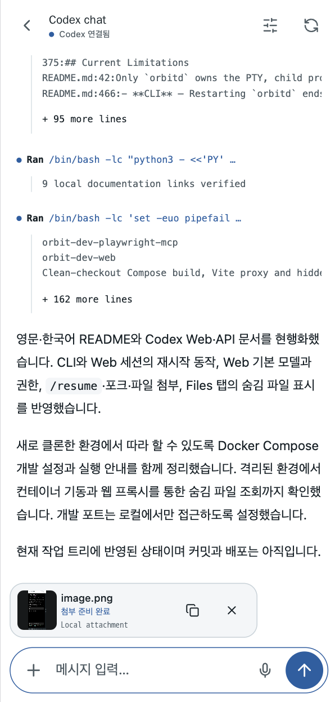
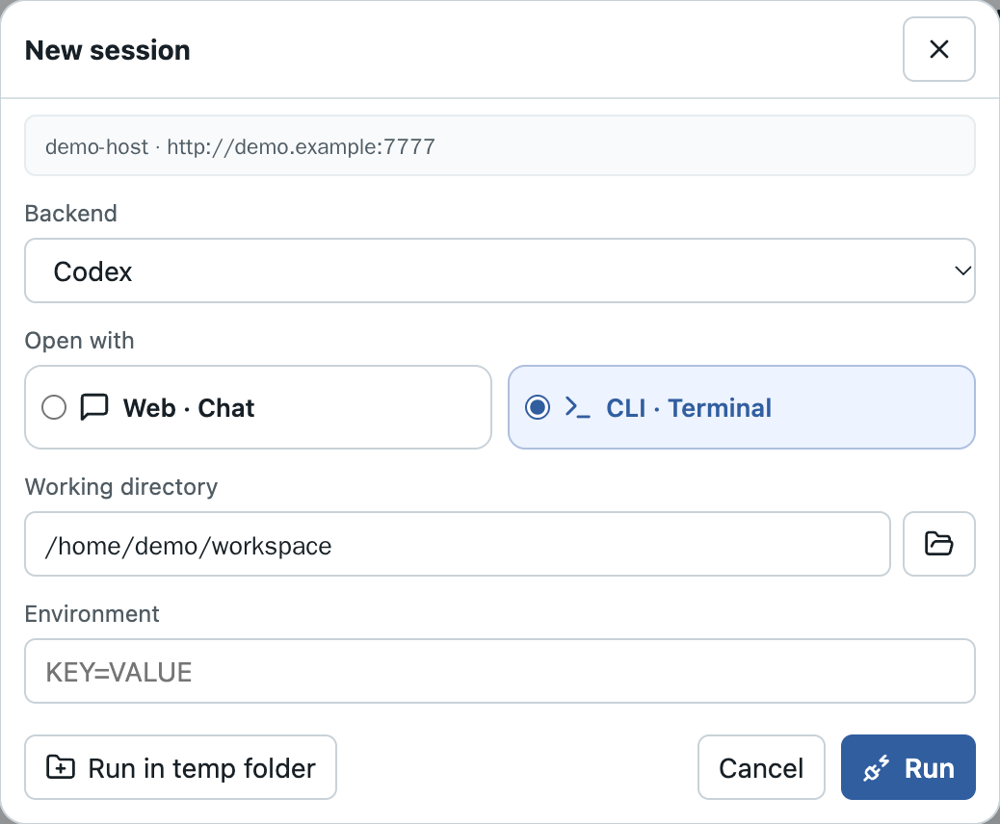
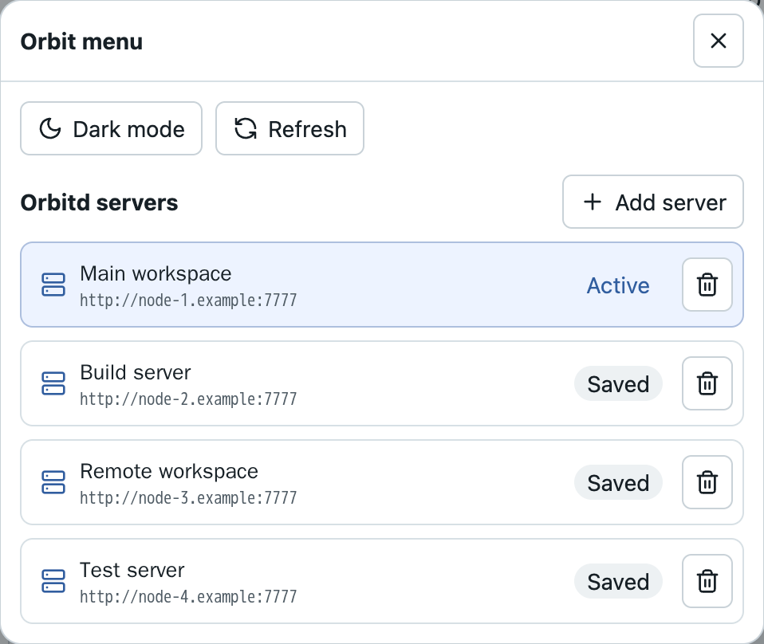

# Orbit

[한국어 문서](docs/ko/README.md)

> A lightweight daemon for managing and multiplexing configurable AI coding agent sessions.

Orbit decouples AI coding agent sessions from your terminal. The `orbitd` daemon owns all PTY processes, sessions, and logs. The `orb` client (TUI or CLI) connects via REST/WebSocket — you can detach, reattach, and inspect sessions independently of your terminal lifetime.

## Features

- **Session management** — Create, list, attach, stop, and delete coding agent sessions.
- **Detach / reattach** — Start a session, detach with `Ctrl-]`, and reconnect later from any terminal.
- **Triple client** — Full-featured [Bubble Tea](https://github.com/charmbracelet/bubbletea) TUI, a CLI interface, and a **web UI** (React + xterm.js, installable PWA metadata).
- **WebSocket attach** — Raw PTY I/O relay with automatic terminal color adaptation (light/dark background detection).
- **Scrollback + logs** — Sessions keep a configurable scrollback buffer; logs are persisted in-memory and as raw files.
- **Configurable agent backends** — `orbitd` reads backend command definitions from YAML, while keeping `codex`, `claude`, `opencode`, and `pi` defaults.
- **REST API + filesystem API** — JSON API for sessions, directory browsing, folder creation, and text file read/write.
- **Web workspace** — Browser-based terminal attach, native Codex chat, a file tree that shows hidden entries, text editing, and multiple `orbitd` connection profiles.
- **Audit trail** — All session lifecycle events are recorded to `audit.jsonl`.

## Screenshots



### Mobile terminal and chat

<p>
  
  
</p>

### Creating sessions and managing servers

<p>
  
  
</p>

## Architecture

```
Terminal                    Browser (web UI)
(orb TUI/CLI)                      |
       |                   web/backend (Fastify)
       |                   (same-origin reverse proxy)
       |                           |
       |  REST: sessions CRUD, logs, filesystem
       |  WebSocket: PTY attach or Codex chat
       v
       orbitd (Rust + axum)
              |
              +-------> configured agent backends (PTY child processes)
              +-------> existing Codex App Server (Web sessions)
              |
              | In-memory SQLite (sessions + logs)
              | Raw log files (./tmp/<id>.log)
              | JSONL audit log (~/.local/share/orbit/audit.jsonl)
```

Only `orbitd` owns the PTY, child processes, and filesystem API. The TUI, CLI, and web UI are all API clients — `orb` and `web/backend` both call `orbitd` through the same REST/WebSocket API. The web backend acts as a same-origin reverse proxy so the browser can reach `orbitd` without cross-origin issues. For the web UI, each browser request may select an upstream `orbitd` using the stored connection profile; `ORBITD_URL` remains the backend fallback.

## Quick Start

On Linux with systemd, clone the repository and run the installer from its root.
Install Git, a C compiler/linker, [Rust](https://rustup.rs/), and [Go 1.23+](https://go.dev/dl/) first. Make sure `cargo` and `go` are available to your regular user.

Default binary paths:

| Binary   | Default path         |
| -------- | -------------------- |
| `orbitd` | `/opt/orbit/orbitd`  |
| `orb`    | `~/.local/bin/orb`   |

### Install from the checkout

```bash
git clone https://github.com/deagwon97/orbit.git
cd orbit
sudo bash script/install.sh
export PATH="$HOME/.local/bin:$PATH"
orb ps
```

Add the `export` line to your shell profile if needed. `orb ps` checks that the
client can reach the daemon. To launch a Codex session, install the Codex CLI
on the orbitd host and make sure the service user can run it.

### Install a published build

If [GitHub Releases](https://github.com/deagwon97/orbit/releases) has binaries
for your Linux architecture, you can use `curl` and the installer to download
them. If there is no matching release, use the checkout commands above.

```bash
sudo bash script/install.sh --prebuilt
```

### Upgrade

Run the installer again from the updated checkout. It prepares both binaries
before replacing either and preserves existing systemd and `orb` connection
settings. The systemd service restarts after replacement, so finish work in
running CLI sessions before upgrading. Web sessions can reconnect to their
saved Codex conversation after the restart.

### After install

`orbitd` is already running as a system service. Connect with the client:

```bash
orb            # launch the TUI
orb ps         # list running sessions
orb run codex  # create a session and attach
```

`orbitd` listens on `127.0.0.1:7777` and uses these files:

| Path                               | Purpose                                             |
| ---------------------------------- | --------------------------------------------------- |
| `/etc/orbitd/token`                | Bearer token for client auth (auto-generated)       |
| `/etc/orbitd/config.yaml`          | Optional config file (also holds backend overrides) |
| `~/.local/share/orbit/audit.jsonl` | Session audit trail                                 |

`orb` reads its own files:

| Path                              | Purpose                                                   |
| --------------------------------- | --------------------------------------------------------- |
| `~/.config/orbit/orb/config.yaml` | Optional client config (orbitd URL)                       |
| `~/.config/orbit/orb/token`       | Bearer token (typically a symlink to `/etc/orbitd/token`) |

### Install script options

```
sudo bash script/install.sh [OPTIONS]

  -p, --prebuilt          Download pre-built binaries from GitHub releases
  -b, --build             Build from source (default)
  -v, --version VERSION   Specific release tag, e.g. v0.2.0 (default: latest)
      --orbitd-dir DIR    Override orbitd install directory (default: /opt/orbit)
      --orb-dir DIR       Override orb install directory (default: ~/.local/bin)
      --install-dir DIR   Legacy: install both binaries into DIR
      --no-systemd        Install binaries without contacting systemd
  -h, --help              Show all options
```

## Usage

### TUI

```
┌───────────────────────────────────────────────────┐
│ Orb Sessions  running                             │
│                                                   │
│  ID           NAME           TOOL        STATUS   │
│ > abc12345    codex-abc12   codex       running   │
│   def67890    ...           claude      running   │
│                                                   │
│ enter/a attach | n create/run | x remove          │
│ l logs | tab toggle filter | r refresh | q quit   │
│ Ctrl-]/Ctrl-\ detach (while attached)             │
└───────────────────────────────────────────────────┘
```

| Key                | Action                                        |
| ------------------ | --------------------------------------------- |
| `↑`/`↓` or `k`/`j` | Move selection                                |
| `enter` or `a`     | Attach to selected session                    |
| `n`                | Open session creation form                    |
| `x`                | Delete selected session                       |
| `l`                | Show last 100 log chunks for selected session |
| `tab`              | Toggle between running / all sessions filter  |
| `r`                | Refresh session list                          |
| `q` or `Ctrl-C`    | Quit                                          |

**Session creation form** — navigate with `tab`/`↑`/`↓`, edit with typing, toggle with `←`/`→`:

| Field    | Description                                           |
| -------- | ----------------------------------------------------- |
| `tool`   | Backend ID from `orbitd` (←/→ to cycle)               |
| `name`   | Optional session name                                 |
| `cwd`    | Optional working directory (defaults to current dir)  |
| `env`    | Space-separated `KEY=VALUE` pairs                     |
| `detach` | `true` → return to list; `false` → attach immediately |

**When attached**: press `Ctrl-]` or `Ctrl-\` to detach while keeping the session running. If your terminal intercepts those keys, `Ctrl-G`, `Ctrl-^`, or `Ctrl-_` also work.

### CLI

```bash
orb                    # launch TUI (no arguments)
orb backends           # list agent backends available from orbitd
orb ps                 # list running sessions
orb ps --all           # list all sessions (including stopped/crashed)
orb ps -a              # shorthand for --all

orb run codex          # create a session and attach
orb run --detach codex # create without attaching
orb run --name my-session --cwd /path/to/project codex
orb run -e KEY=VALUE -e FOO=bar codex

orb attach <id>        # attach to session by ID or name
orb logs <id>          # print all logs
orb logs --tail 50 <id>   # last 50 log chunks
orb logs --raw <id>    # print raw PTY output (no ANSI filtering)

orb rm <id>...         # delete one or more sessions by ID or name
```

### API

Base: `http://127.0.0.1:7777` — all endpoints except `/healthz` require `Authorization: Bearer <token>`.

| Method   | Path                               | Description                                      |
| -------- | ---------------------------------- | ------------------------------------------------ |
| `GET`    | `/healthz`                         | Health check (no auth)                           |
| `GET`    | `/api/v1/backends`                 | List agent backends available to `orbitd`        |
| `POST`   | `/api/v1/sessions`                 | Create a session                                 |
| `GET`    | `/api/v1/sessions`                 | List sessions (`?status=running`, `?tool=codex`) |
| `GET`    | `/api/v1/sessions/:id`             | Get session by ID or name                        |
| `POST`   | `/api/v1/sessions/:id/stop`        | Stop a running session                           |
| `DELETE` | `/api/v1/sessions/:id`             | Delete session (kills process if running)        |
| `GET`    | `/api/v1/sessions/:id/logs?tail=N` | Get base64-encoded log chunks                    |
| `GET`    | `/api/v1/sessions/:id/attach`       | WebSocket for live CLI terminal attach           |
| `GET`    | `/api/v1/sessions/:id/codex`        | WebSocket for Codex Web chat                      |
| `GET`    | `/api/v1/fs/dirs?path=...`         | List visible subdirectories for a path           |
| `POST`   | `/api/v1/fs/dirs`                  | Create a child directory                         |
| `GET`    | `/api/v1/fs/entries?path=...`      | List files and directories, with optional `include_hidden=true` |
| `GET`    | `/api/v1/fs/files?path=...`        | Read a UTF-8 text file, up to 10 MB              |
| `POST`   | `/api/v1/fs/files`                 | Create an empty file with `parent` and `name`   |
| `PUT`    | `/api/v1/fs/files`                 | Write UTF-8 text content to a file               |

**Create session** request body:

```json
{
  "tool": "codex",
  "name": "my-session",
  "cwd": "/home/user/project",
  "env": { "KEY": "VALUE" }
}
```

The `tool` field is a backend ID from `/api/v1/backends`. The optional `mode` defaults to `cli`. For a supported Codex backend, send `mode: "web"` with an empty or omitted `env` object. See the [API reference](orbitd/API.md) for attachment routes.

**WebSocket attach** — JSON-framed messages:

```
→ { "type": "stdin",  "data": "<base64>" }
→ { "type": "resize", "cols": 120, "rows": 40 }
→ { "type": "detach" }
← { "type": "stdout", "data": "<base64>" }
```

**Filesystem API** — `path` defaults to `$ORBIT_WORKSPACE` when set, otherwise the `orbitd` process working directory. The Files tab requests `include_hidden=true` on `/api/v1/fs/entries` to show hidden files and directories. API calls without this parameter and the folder picker omit hidden entries. Directory listings return canonical paths plus `parent` and `home` references; file reads reject non-files, non-UTF-8 content, and files larger than 10 MB.

## Configuration

### orbitd (daemon)

`orbitd` reads `/etc/orbitd/config.yaml` if it exists. Backends and PTY tuning all
live in this single file:

```yaml
listen: "127.0.0.1:7777"

pty:
  scrollback_lines: 10000
  scrollback_max_bytes: 104857600

# Optional — overrides the built-in backend registry.
backends:
  - id: aider
    name: Aider
    command: aider
    args:
      - --yes-always
  - id: local-agent
    command: /usr/local/bin/local-agent
    args: ["--mode", "workspace"]
```

Default paths and runtime settings:

| Setting                | Default                                    | Environment override |
| ---------------------- | ------------------------------------------ | -------------------- |
| `listen`               | `127.0.0.1:7777`                           | —                    |
| `config_path`          | `/etc/orbitd/config.yaml`                  | `ORBITD_CONFIG`      |
| `token_path`           | `/etc/orbitd/token`                        | `ORBITD_TOKEN_PATH`  |
| `data_dir`             | `~/.local/share/orbit`                     | `ORBIT_DATA_DIR`     |
| `codex_socket`         | `app-server-control/app-server-control.sock` under `CODEX_HOME` or `~/.codex` | `ORBIT_CODEX_SOCKET` |
| `session_logs_dir`     | `./tmp` (relative to `orbitd` working dir) | —                    |
| `audit_path`           | `~/.local/share/orbit/audit.jsonl`         | —                    |
| `process_path`         | `$PATH` from server environment            | —                    |
| `scrollback_lines`     | 10,000                                     | —                    |
| `scrollback_max_bytes` | 100 MB                                     | —                    |

### orb (client)

`orb` reads `~/.config/orbit/orb/config.yaml` if it exists. Example:

```yaml
url: "http://127.0.0.1:7777"
```

| Setting       | Default                                      | Environment override |
| ------------- | -------------------------------------------- | -------------------- |
| `config_path` | `~/.config/orbit/orb/config.yaml`            | `ORB_CONFIG`         |
| `token_path`  | `~/.config/orbit/orb/token`                  | `ORB_TOKEN_PATH`     |
| `url`         | `http://127.0.0.1:7777` (from `config.yaml`) | —                    |

## Agent Backends

By default, `orbitd` exposes these backend IDs:

| Backend ID | Command    | Extra args                                   |
| ---------- | ---------- | -------------------------------------------- |
| `codex`    | `codex`    | `--dangerously-bypass-approvals-and-sandbox` |
| `claude`   | `claude`   | `--dangerously-skip-permissions`             |
| `opencode` | `opencode` | _(none)_                                     |
| `pi`       | `pi`       | _(none)_                                     |

To replace the defaults, add a `backends` list to `/etc/orbitd/config.yaml`:

```yaml
backends:
  - id: aider
    name: Aider
    command: aider
    args:
      - --yes-always
  - id: local-agent
    command: /usr/local/bin/local-agent
    args: ["--mode", "workspace"]
```

The TUI, CLI, and web UI read the available backend list from `GET /api/v1/backends`.

## Build from Source

### Daemon (Rust)

```bash
cd orbitd
cargo build --workspace      # full workspace
cargo build -p orbitd         # daemon only
cargo build -p orbitd --release
# Binary: target/debug/orbitd or target/release/orbitd
```

### Client (Go)

```bash
cd orb
go build -o orb .
# Binary: ./orb
```

### Verification

```bash
(cd orbitd && cargo test --locked --workspace)
(cd orb && go test ./... && go build -o orb .)
```

### Web UI (optional)

The Vite frontend uses a Fastify reverse proxy to reach the selected `orbitd` server. Server labels, URLs, and tokens are stored in the browser. Use **Orbit menu → Add server** to connect. The URL must be reachable from the web backend.

#### Run locally from a fresh checkout

With `orbitd` running and Node.js 22 installed, run these commands from the repository root in two terminals.

```bash
# Terminal 1
npm ci --prefix web/backend
npm run dev --prefix web/backend

# Terminal 2
npm ci --prefix web/frontend
npm run dev --prefix web/frontend
```

Open the URL printed by Vite. For the default local daemon, add `http://127.0.0.1:7777` and use the token from `~/.config/orbit/orb/token` or `/etc/orbitd/token`.

| Variable | Default | Purpose |
| --- | --- | --- |
| `PORT` | `3001` | Web backend listen port |
| `ORBITD_URL` | `http://127.0.0.1:7777` | Web backend's fallback daemon URL |
| `ORBIT_TOKEN` | empty | Fallback Bearer token when a connection supplies none |
| `ORBIT_API_URL` | `http://127.0.0.1:3001` | Vite's development proxy target |

#### Run with Docker Compose

```bash
mkdir -p .playwright-mcp/output
docker compose -f docker-compose.dev.yaml up -d --build
```

Open `http://localhost:14000`. The API is on `http://localhost:14001`, and the local Playwright MCP endpoint is `http://127.0.0.1:18932/mcp`. Inside that Playwright container, open `http://orbit-dev-web:3000`.

The backend uses `http://host.docker.internal:7777` for a daemon on the Docker host. The daemon must listen on an internal address reachable from Docker. Use that same URL when adding the connection. The daemon token is mounted read-only from `/etc/orbitd/token`. Set `ORBIT_TOKEN_PATH` to use another token file.

Source edits reload automatically. After changing dependencies, run `docker compose -f docker-compose.dev.yaml run --rm --no-deps orbit-dev-web npm ci` for the frontend or substitute `orbit-dev-api` for the backend. Stop the stack with `docker compose -f docker-compose.dev.yaml down`.

#### Codex CLI and Web sessions

Choose **CLI · Terminal** for a PTY or **Web · Chat** for the integrated chat. Web mode uses the existing Codex App Server on the selected host. It requires a Codex daemon socket accessible to the `orbitd` service user.

New Web conversations default to **`gpt-6.2-sol · medium · Fast · YOLO`**. YOLO grants full filesystem access and does not prompt for approval. Use `/model`, `/fast`, and `/permissions` to change the current conversation. `/resume` switches to a saved conversation within the same Orb session. **Fork here** opens a separate session from a completed turn. The attachment picker supports images and general files, at up to 50 MiB each.

See the [Codex Web guide](docs/ko/CODEX-WEB.md) for setup, command details, and session behavior.

## systemd Service

`script/install.sh` registers `orbitd` as a system service automatically.
The generated unit file (`/etc/systemd/system/orbitd.service`) looks like:

```ini
[Unit]
Description=AI Agent Orbit
After=network.target

[Service]
Type=simple
User=ubuntu
Environment=PATH=/home/ubuntu/.local/bin:/home/ubuntu/.nvm/versions/node/v24.16.0/bin:/usr/local/sbin:/usr/local/bin:/usr/sbin:/usr/bin:/sbin:/bin
ExecStart=/opt/orbit/orbitd
Restart=on-failure
RestartSec=5

[Install]
WantedBy=multi-user.target
```

`User` is set to the invoking user (not root, even when `sudo` is used).
The generated `PATH` includes the invoking user's shell `PATH`, `~/.local/bin`,
standard system directories, the active Node.js bin directory, and
`~/.nvm/versions/node/*/bin` directories when present. Backend commands can still
be defined with absolute paths in `/etc/orbitd/config.yaml` when needed — see
[Agent Backends](#agent-backends).

**Common service commands:**

```bash
sudo systemctl status orbitd      # check status
sudo systemctl restart orbitd     # restart after config change
sudo systemctl stop orbitd        # stop the daemon
sudo systemctl disable orbitd     # remove from autostart
journalctl -u orbitd -f           # follow logs
```

To install the binaries and run the daemon as your own user, run these commands from the repository root.

```bash
sudo bash script/install.sh --no-systemd
export ORBITD_CONFIG="$HOME/.config/orbit/orbitd/config.yaml"
export ORBITD_TOKEN_PATH="$HOME/.config/orbit/orbitd/token"
/opt/orbit/orbitd
```

In another shell, run `ORB_TOKEN_PATH="$HOME/.config/orbit/orbitd/token" "$HOME/.local/bin/orb" ps` to check the connection.

### Uninstall

Remove the service and installed binaries:

```bash
sudo bash script/uninstall.sh
```

To also remove `/etc/orbitd`, `~/.config/orbit/orb`, and `~/.local/share/orbit`, pass `--purge`:

```bash
sudo bash script/uninstall.sh --purge
```

## Session Lifecycle

```
created  →  running  →  stopped    (normal exit)
                      →  crashed    (non-zero exit / error)
                      →  removed    (DELETE API / TUI rm)
```

- **CLI** — Restarting `orbitd` ends the running PTYs and clears the in-memory session registry. Raw PTY logs in `./tmp/<id>.log` remain on disk.
- **Codex Web** — `orbitd` restores the saved Orb session and Codex thread mapping from `$ORBIT_DATA_DIR/codex-sessions/` (default `~/.local/share/orbit/codex-sessions/`). The Codex App Server owns the conversation history. Unsent queue entries are lost when `orbitd` restarts.

## Troubleshooting

| Problem                | Check                                                                                                                                                               |
| ---------------------- | ------------------------------------------------------------------------------------------------------------------------------------------------------------------- |
| TUI auth failure       | Ensure `~/.config/orbit/orb/token` exists (symlink to `/etc/orbitd/token` works); start `orbitd` once to generate the source token                                  |
| Connection refused     | Is `orbitd` running on `127.0.0.1:7777`? Check server logs                                                                                                          |
| Web UI can't connect   | Is the web backend running on port 3001? Is the selected connection URL correct? Is the token set via `ORBIT_TOKEN` env or entered in the Orbitd connection screen? |
| Session creation fails | Is the backend ID listed by `orb backends`? Is its command on `PATH`, or configured as an absolute path?                                                            |
| "Cannot attach"        | Session may have already exited and been cleaned up                                                                                                                 |
| Build errors (Rust)    | Ensure `pkg-config` and `libdbus-1-dev` are installed (`portable-pty` dependency)                                                                                   |

## License

Apache 2.0
